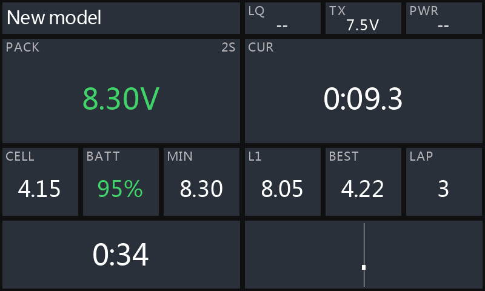
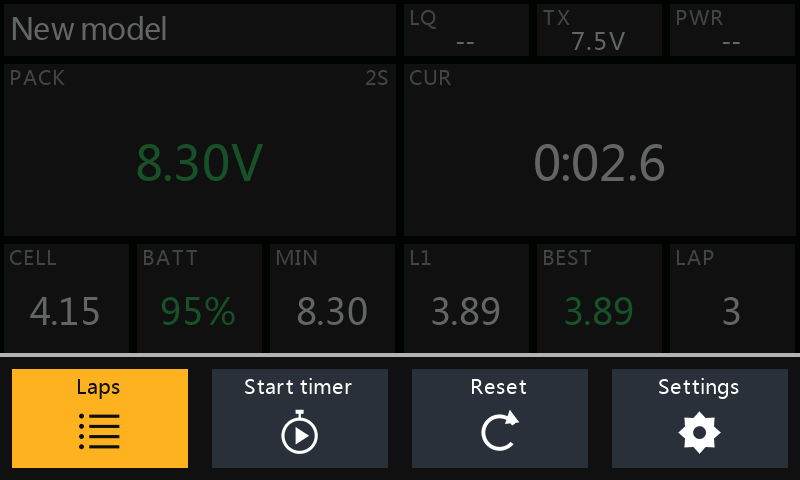
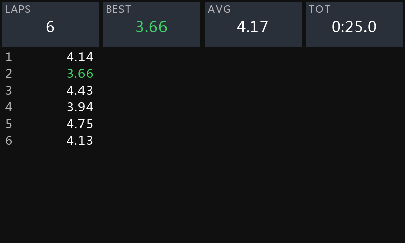
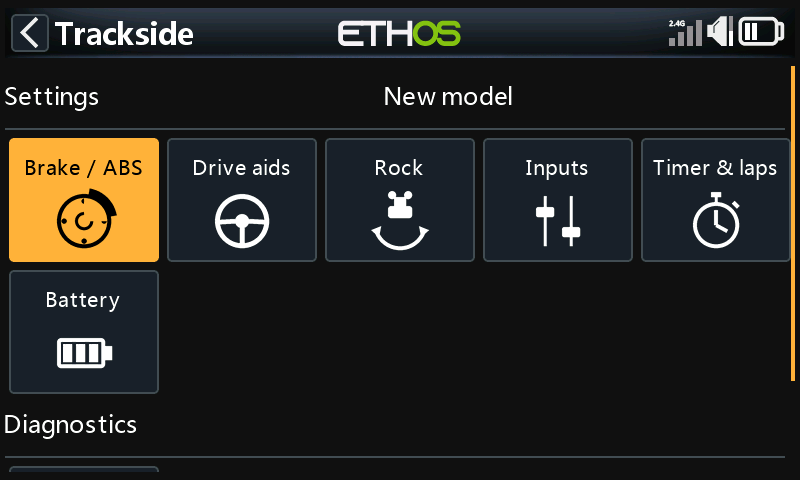
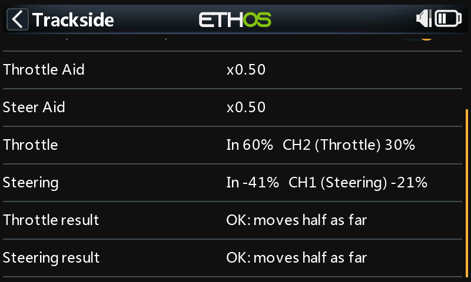
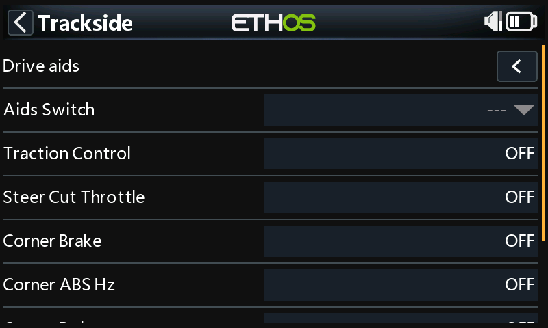

# Trackside

Race dashboard and drive aids for the **FrSky Velox VX10** surface radio (FrSky Ethos).

**Latest release: [0.1.0](https://github.com/robthomson/trackside/releases/tag/release/0.1.0)**
([release notes](Releases.md), [setup guide PDF](docs/Trackside-Setup-Guide.pdf)).

> **Status:** all of Phase 1 works in the VX10 simulator (Ethos 26.2), measured on the channel outputs.
> It has **not yet been driven on a real VX10**, so try everything on the bench first. Every drive aid is
> OFF in a new model, so the car drives exactly as before until you turn one on.

## What it does

- **Drive aids:** ABS (Static / Dynamic), Traction Control, Steer Cut Throttle, Corner Brake and
  Steer Limit. They use only your trigger, wheel and time (no telemetry), and an **Aids Switch** turns
  them all on or off.
- **Built-in safety:** if Trackside hits an error the aids let the sticks straight through, and the
  LS1 safety switch turns the aid mix lines off if Trackside is missing or stops.
- **Race dashboard:** pack voltage and cells, fuel, lowest voltage, current / last / best lap and lap count,
  aid letters, a live throttle / brake / steering bar, and the race countdown. **Swipe up** for a toolbar
  with the lap view, timer start / pause, reset and settings.
- **Lap timer and countdown** on switches, with lap haptics.
- **Spoken alerts:** lap times and "best lap", fuel 50 / 30 / 20 / 10%, "battery low", "one minute" and
  "time up", drive aids on / off.
- **Fuel** from a fuel sensor if the car has one, otherwise from mAh used or resting voltage, published
  as a telemetry sensor (Pack Fuel) for alerts and other widgets.
- **Trackside tool** (System menu): every setting per model, and **Check setup**, whose Aid Test shows
  channel by channel whether your mixes are right.

## Screenshots

From the VX10 simulator.

<table>
  <tr>
    <td></td>
    <td></td>
  </tr>
  <tr>
    <td>Racing: lap 3 running, best lap, countdown in the footer</td>
    <td>Swipe up for the toolbar: laps, timer, reset, settings</td>
  </tr>
  <tr>
    <td></td>
    <td></td>
  </tr>
  <tr>
    <td>Lap view: every lap, best in green, with average and total</td>
    <td>The Trackside tool: settings per model, and Check setup</td>
  </tr>
  <tr>
    <td></td>
    <td></td>
  </tr>
  <tr>
    <td>Check setup: the Aid Test proves the mixes work</td>
    <td>Drive aids, with the Aids Switch at the top</td>
  </tr>
</table>

## Install

Download `trackside-<version>.zip` from the [releases](https://github.com/robthomson/trackside/releases)
and install it with Ethos Suite, or copy the zip's `trackside` folder into the radio's `SCRIPTS` folder.
Needs Ethos 26.1 or later (tested on 26.2).

Then set up your car model. The [setup guide](docs/Trackside-Setup-Guide.pdf) walks through it with
screenshots; in short:

1. **Model → Lua:** turn on **Throttle Aid** and **Steer Aid**.
2. **Mixes:** after the Throttle and Steering mixes, add one Free mix each: source Lua → the aid,
   Operation **Multiply**, Output the same channel.
3. **Safety switch:** give both aid lines the Active condition **LS1** (`A > X`, Source Telemetry →
   **Trackside**, Value 0).
4. **System → Trackside → Check setup:** turn on the Aid Test. Both results should read **OK**.
5. **Screens:** add a full-screen page with the **Trackside** widget.

Your settings are saved per model in `SCRIPTS/trackside.user`, so updating Trackside keeps them.

## What's in it

| Part | Ethos item | What it does |
| --- | --- | --- |
| Throttle Aid, Steer Aid | Lua sources | Multipliers used on Multiply mix lines for throttle and steering |
| Trackside | Telemetry sensor (created automatically) | Reads 1 while Trackside runs; logic switch LS1 uses it to turn the Multiply lines off if Trackside stops |
| Pack Fuel | Telemetry sensor (created automatically) | Fuel % from mAh used or resting voltage, when the car has no fuel sensor |
| Trackside | Widget | Race dashboard, lap view and the swipe-up toolbar |
| Trackside | System tool | Settings (Brake / ABS, Drive aids, Inputs, Timer & laps, Battery), saved per model, and Check setup with the Aid Test |

## Roadmap

Phase 1 (the core feature set) is done in the simulator; see [docs/ROADMAP.md](docs/ROADMAP.md) and the
feature checklist in [docs/FEATURES.md](docs/FEATURES.md). Next:

- **Bench and track test on a real VX10:** the Lua update rate (it sets the usable ABS range), sensor names
  from real receivers and ESCs, and spoken alerts over the car.
- Then ideas such as an **event mode** that locks out anything not race-legal, presets per track or surface,
  spoken lap deltas, session history and a live tuning graph.

## Layout

```
src/trackside/         -> SCRIPTS/trackside/ on the radio
  main.lua             registers the sources, the widget and the system tool
  lib/settings.lua     settings schema (ranges/defaults) + per-model save
  lib/core.lua         drive-aid pipeline: traction, steer cut, corner brake, ABS, steer limit
  lib/form.lua         settings fields generated from the schema (loaded on first use)
  lib/telemetry.lua    sensor values (simulator file or real sensors)
  lib/battery.lua      cell count, cell V, %, session minimum
  lib/fuel.lua         fuel %: fuel sensor, else mAh used, else resting voltage
  lib/diysensor.lua    telemetry sensors Trackside creates (Trackside, Pack Fuel)
  lib/audio.lua        spoken phrases (user file, radio voice, en/default) and numbers
  lib/alerts.lua       voltage alarm, fuel callouts, Aid Test and Aids Switch announcements
  lib/laps.lua         lap timer (lap switch, best, callouts) and session countdown
  tool/app.lua         Trackside system tool: menu, settings pages, Check setup
  tool/gfx/            tool icons
  widget/home.lua      dashboard, lap view and toolbar
  widget/gfx/          toolbar icons
  audio/               spoken phrases (en default / us / gb)
bin/audio/             phrase list + generator (Google Text-to-Speech or offline Windows speech)
bin/icons/             draws the tool and toolbar icons
bin/manual/            builds the setup guide PDF
bin/package/           builds and checks the release zip
bin/sensors/           simulator sensor tool
docs/
  FEATURES.md          Phase 1 feature spec + status
  RESEARCH.md          how racers use these features, race rules on driver aids
  ROADMAP.md           phases, design principles, ideas
  SETUP.md             short text version of the setup guide
.github/               build and release workflows
.vscode/               deploy tooling
```

## Development

Requirements: VS Code with the Ethos extension, Python 3 (packages install automatically on first deploy;
see `requirements.txt`).

Run tasks from the VS Code Run and Debug panel:

| Task | Does |
| --- | --- |
| Deploy & Launch [SIM] | Copies `src/trackside` into `simulators/VX10_FCC@nightly26/scripts/` and starts the Ethos simulator |
| Deploy Radio / [Fast] | Copies to a USB-connected radio (Fast = changed files only) |
| Deploy Radio + Serial Debug | Deploy, then stream `print()` output from the radio |
| Radio: Serial Debug | Serial debug only |
| Simulator: Sensors | Opens the simulated telemetry window (below) |

The simulator board is set in [.vscode/settings.json](.vscode/settings.json) (`VX10`, `FCC`, `nightly26`).

**Setup guide:** rebuild [docs/Trackside-Setup-Guide.pdf](docs/Trackside-Setup-Guide.pdf) with
`python bin/manual/build_manual.py` (screenshots in `docs/manual/images`, captured from the VX10 simulator).

**Spoken phrases:** add them to `bin/audio/phrases.json` and run `python bin/audio/generate.py`.

### Releases

| Trigger | Workflow | Result |
| --- | --- | --- |
| push to `main` / a pull request | `push.yml` / `pr.yml` | test zip as a build artifact |
| tag `snapshot/<version>` | `snapshot.yml` | GitHub pre-release with the zip and the setup guide |
| tag `release/<version>` (`-rcN` = candidate) | `release.yml` | GitHub release with the zip and the setup guide |

Release notes come from the `# <version>` section of [Releases.md](Releases.md). Build a zip locally with
`python bin/package/build_package.py --artifact-version 0.1.0` (checked with `bin/package/validate_manifest.py`).

### Simulated telemetry

Run **Simulator: Sensors** (or `python bin/sensors/sensors.py`) while the simulator is running. It opens a
window with sliders for link quality, TX power, pack voltage, current, mAh used, a fuel sensor (with a
"fitted" tick box), ESC/motor temp and RPM, and writes them live to `SCRIPTS/trackside.user/sim/sensors.lua`
in the simulator folder. The dashboard reads that file only when Ethos reports it's running in the simulator.
Sensors are defined in [bin/sensors/sensors.xml](bin/sensors/sensors.xml). If the simulator folder is
recreated (for example by a simulator update), run the tool once to write the file again.
